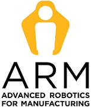

# RobotRaconteur.Sharp

**RobotRaconteur.Sharp is a pure C\# implementation of the Robot Raconteur framework for use with .NET!**

Robot Raconteur is a communication framework for robotics, automation, and the Internet of Things. RobotRaconteur.Sharp
is an implementation of Robot Raconteur developed in pure C#. This is in contrast to RobotRaconteurNET, which
is a wrapper for the native RobotRaconteurCore implementation that is developed in C++. RobotRaconteur.Sharp
is more portable since it is pure C#. For web browsers, use the Robot Raconteur TypeScript implementation, or
RobotRaconteur.Sharp with Blazor WebAssembly. RobotRaconteur.Sharp can also be used with ASP.NET web servers using
WebSockets. See the [ASP.NET Core server example](https://github.com/robotraconteur/RobotRaconteurWeb/tree/master/examples/aspnet_server) for a demonstration. This capability allows for Robot Raconteur to
be easily integrated into cloud and information systems without requiring any modifications to the infrastructure!

RobotRaconteur.Sharp was formerly named RobotRaconteurWeb.

**See the Documentation here!!** [RobotRaconteur.Sharp Documentation](https://github.com/robotraconteur/RobotRaconteurWeb/wiki/Documentation)

RobotRaconteur.Sharp is very similar to RobotRaconteurNET. The main difference is that RobotRaconteur.Sharp
uses the asynchronous Task framework instead of blocking. All function that could potentially block
are instead asynchronous, and should be used with async/await.

See the `examples/` directory for examples of how to use RobotRaconteur.Sharp.

See the RobotRaconteurCore documentation for more information on Robot Raconteur and how to use the library:
https://github.com/robotraconteur/robotraconteur/wiki/Documentation

## Robot Raconteur

Robot Raconteur as framework and ecosystem is documented on the Robot Raconteur product page and GitHub homepage.
The tutorials are targeted at Python and C++, however the concepts are identical regardless of the programming
language interface used. It is recommended the user familiarizes themselves with the framework using Python
before using C\#.

* Homepage: http://robotraconteur.com
* GitHub Page: https://github.com/robotraconteur/robotraconteur
* Documentation Listing: https://github.com/robotraconteur/robotraconteur/wiki/Documentation
* RobotRaconteurCore: https://github.com/robotraconteur/robotraconteur

## Installation
### .NET Installation

`RobotRaconteur.Sharp` can be easily installed using the NuGet package:

* NuGet RobotRaconteur.Sharp homepage: https://www.nuget.org/packages/RobotRaconteur.Sharp/

Copyright (C) 2024 Wason Technology, LLC

## Acknowledgment

This work was supported in part by the Advanced Robotics for Manufacturing ("ARM") Institute under Agreement Number W911NF-17-3-0004 sponsored by the Office of the Secretary of Defense. The views and conclusions contained in this document are those of the authors and should not be interpreted as representing the official policies, either expressed or implied, of either ARM or the Office of the Secretary of Defense of the U.S. Government. The U.S. Government is authorized to reproduce and distribute reprints for Government purposes, notwithstanding any copyright notation herein.

This work was supported in part by the New York State Empire State Development Division of Science, Technology and Innovation (NYSTAR) under contract C160142.

 
